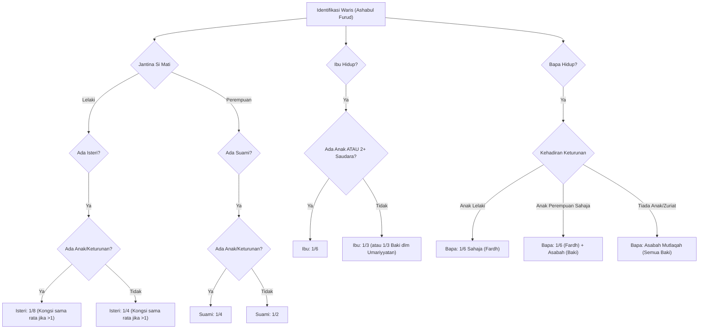
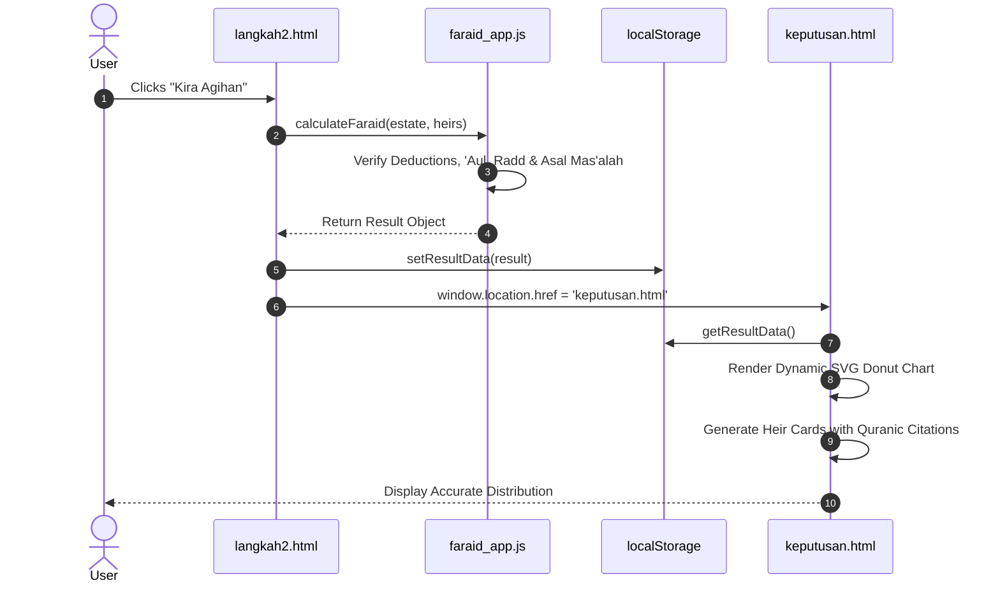
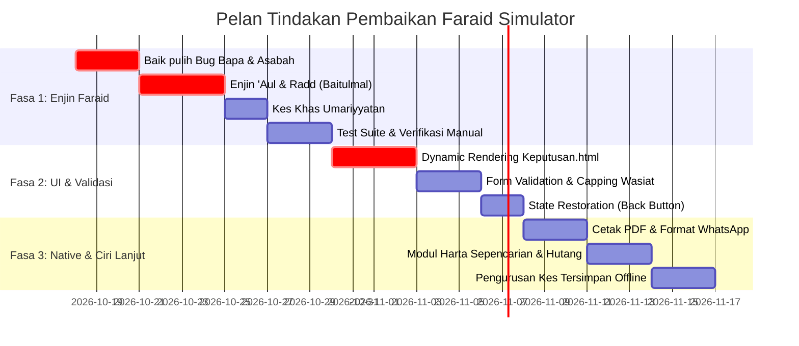

# Product Requirements Document (PRD) & Comprehensive Feature Audit
## Faraid Simulator Malaysia (Simulator Faraid & Perancangan Harta Islam)

> **Document Version:** 1.0.0  
> **Target Standard:** Malaysian State Shariah Enactments / Mazhab Shafi'i Legal Framework  
> **Platform:** Android Hybrid (Kotlin + Android WebView + Tailwind CSS / Vanilla JS)  
> **Repository:** `c:\Users\ash_s\develop\projects\Faraid-Sim-Malaysia`  
> **Date of Audit:** October 2024 / Review Baseline 2025–2026

---

## 1. Executive Summary & Scope

### 1.1 Purpose of the Application
**Faraid Simulator Malaysia** is a mobile hybrid application designed to assist Malaysian Muslims, legal practitioners, estate planners, and heirs in understanding, estimating, and simulating the distribution of deceased estates (*tirkah*) in compliance with:
1. **Mazhab Shafi'i Jurisprudence** (*Fiqh Mawarith*): The primary statutory school of Islamic jurisprudence recognized in Malaysia.
2. **State Shariah Law & Enactments**: Islamic Family Law Enactments (*Enakmen Undang-Undang Keluarga Islam*) and Administration of Islamic Law Enactments across Malaysian States.
3. **Malaysian Civil Statutory Framework**:
   - *Small Estates (Distribution) Act 1955 (Akta Harta Pusaka Kecil 1955 - Act 98)* — JKPTG jurisdiction for estates with immovable property up to RM5,000,000.
   - *Probate and Administration Act 1959 (Act 97)* — High Court jurisdiction.
   - *Public Trust Corporation Act 1995 (Amanah Raya Berhad)* — Movable assets under RM600,000.
   - *National Fatwa Council Rulings*: Status of nominees (*Wasi*) for EPF (KWSP) and Tabung Haji.

### 1.2 Target Audience
- **General Public (Heirs & Family Members):** Needing quick, transparent insight into inheritance shares before formal court applications.
- **Islamic Wealth Planners & Agents:** Advising clients on Hibah vs Wasiat vs Faraid trade-offs.
- **Legal Aid & Shariah Students:** Visualizing Faraid formulas (*Asal Mas'alah*, *Ashabul Furud*, *'Asabah*, *Hijab*).

### 1.3 Audit Objective
This audit provides an exhaustive evaluation of the codebase scaffolded from Stitch MCP screens (`utama.html`, `langkah1.html`, `langkah2.html`, `keputusan.html`, `panduan.html`, `faraid_app.js`, and `MainActivity.kt`), contrasting current mock behaviors against genuine Shariah mathematical rules and production-grade Android hybrid standards.

---

## 2. Feature Inventory & Current State Audit

### 2.1 Screen-by-Screen Audit Matrix

| Screen / Component | Implemented (Working) | Mocked / Hardcoded | Broken / Missing / Gaps |
| :--- | :--- | :--- | :--- |
| **1. Utama / Dashboard**<br>`utama.html`<br>`index.html` | • Bottom navigation bar switching.<br>• CTA "Mula Kira Sekarang" links to Step 1.<br>• Dynamic Saved Cases system: badge count, modal list, and recent cards synced with `localStorage` (`faraid_saved_cases`).<br>• Saved Cases modal trigger and close backdrop with item delete and load actions.<br>• Recent Cases bottom sheet with View, Share, Rename, and Delete actions synced with storage.<br>• Info icon (ⓘ) opens Material 3 bottom sheet ("Tentang Faraid Simulator") with legal basis, 3-step guide, disclaimer, and official agencies.<br>• Profile icon opens "Profil & Tetapan" bottom sheet with display name, language toggle, and "Padam Semua Data Simulasi".<br>• User preferences stored under `faraid_user_prefs`.<br>• Basic touch ripple micro-interactions. | • Initial seed cases provided for fresh install. | • "Simulasi Hibah" shortcut has `href="#"` (no action). |
| **2. Langkah 1: Harta**<br>`langkah1.html` | • Input fields for Gross, Funeral, Debt, and Wasiat.<br>• Dynamic calculation of `maxAllowedWasiat` (1/3 of post-debt).<br>• Real-time updates to Net Estate display.<br>• Stores data into `localStorage` (`faraid_estate_data`). | • Default initial values pre-filled (RM 550k, 5k, 30k, 15k).<br>• Formula breakdown capsule displays static text `RM 550k − 5k − 30k − 15k` even when inputs change. | • **No validation against negative inputs** (user can input negative values).<br>• **Wasiat capping not enforced**: Exceeding 1/3 only turns text red, allowing user to proceed illegally under Shariah.<br>• **Missing Matrimonial Property (Harta Sepencarian)** deduction.<br>• **No distinction between Hutang Allah (Zakat/Fidyah/Haji) and Hutang Manusia**. |
| **3. Langkah 2: Waris**<br>`langkah2.html` | • Gender selection toggle (Deceased Male/Female).<br>• Spousal count stepper (max 4 for male deceased, max 1 for female deceased).<br>• Child counters (Son, Daughter).<br>• Parent toggles (Father, Mother alive).<br>• Summary text generation. | • Step 1 chip displays hardcoded `1. Harta: RM 500,000` regardless of actual Step 1 input.<br>• Static badges: Father and Mother notes always display `1/6 Bahagian` in the markup.<br>• "Peraturan Penghijaban" collapsible contains static text only. | • **State Loss Bug:** On navigating back or refreshing, heir inputs reset to defaults instead of restoring previous state.<br>• **Limited Heirs Supported:** Omits Grandparents (Datuk/Nenek), Grandchildren, and all Collaterals (Full/Consanguine/Uterine Brothers & Sisters).<br>• **No handling of Umariyyatan case** (Spouse + Parents only). |
| **4. Keputusan Agihan**<br>`keputusan.html` | • Dynamic rendering of calculation results (`faraid_result_data`) for net estate, heir count, SVG donut chart, legend, and detailed heir breakdown cards.<br>• Complete "Simpan Kes" persistence to `faraid_saved_cases` with native toast feedback.<br>• Visual structure, Material Design 3 styling, and typography.<br>• Native Toast trigger via `AndroidBridge.showToast()`.<br>• Native text share via `AndroidBridge.shareText()`.<br>• Hibah simulation toggle collapses/expands info card. | • Asal Mas'alah derivation statically displays 24. | • **No PDF Generation:** "Eksport / Kongsi PDF" button triggers basic text sharing, misleading users. |
| **5. Panduan & Rujukan**<br>`panduan.html` | • Horizontal category filter chips (Semua, Tertib, Waris, Hijab, Hibah).<br>• Interactive FAQ accordion with chevron rotation.<br>• Client-side search input filtering text blocks in real time.<br>• Interactive CTA card "Mula Simulasi Faraid" / "Kira" routes directly to Langkah 1 (`langkah1.html`) with bottom navigation state sync. | • External links to JKSM, JKPTG, and AmanahRaya are dummy links (`href="#"`). | • Search does not automatically highlight query matches.<br>• Lacks bookmarking or direct deep-linking to specific legal sections. |
| **6. Android Hybrid Bridge**<br>`MainActivity.kt`<br>`WebAppInterface.kt` | • WebView configured with DOM storage, file access, JavaScript enabled.<br>• Hardware acceleration and status bar edge-to-edge styling.<br>• Native interface `AndroidBridge` exposed. | • Back button interception uses hardcoded URL substring matching. | • **State wipe on Back navigation:** Back press triggers `webView.loadUrl()`, destroying unsaved in-memory DOM inputs.<br>• Missing native file picker, print adapter, or PDF rendering engine. |

---

## 3. Core Calculation Engine Gap Analysis (`faraid_app.js`)

### 3.1 Estate Deductions Hierarchy (Tertib Hak Ke Atas Tirkah)

Under Shafi'i jurisprudence and Malaysian Shariah practice, deceased assets must be liquidated in a strict hierarchical order before Faraid distribution:

```
[ Harta Kasar (Gross Estate) ]
            │
            ▼
[ 1. Kos Pengurusan Jenazah (Reasonable Funeral Expenses) ]
            │
            ▼
[ 2. Tuntutan Harta Sepencarian (Matrimonial Property - Shariah Court Order) ]
            │
            ▼
[ 3. Hutang Si Mati (Debts & Liabilities) ]
       ├── 3a. Hutang Allah (Zakat, Fidyah, Kaffarah, Haji Badal)
       └── 3b. Hutang Manusia (Secured & Unsecured Debts)
            │
            ▼
[ 4. Wasiat Bukan Waris (Bequests to Non-Heirs) ] ──▶ Capped at ≤ 1/3 of Net After Debts
            │
            ▼
[ 5. Harta Bersih Faraid (Net Distributable Estate) ]
```

#### Gaps Identified in Current Code (`langkah1.html` & `faraid_app.js`):
1. **Omission of Harta Sepencarian:** In Malaysia, surviving spouses frequently apply for Harta Sepencarian (typically 1/3 to 1/2 of jointly acquired assets) under State Islamic Family Law Enactments *prior* to debt/wasiat execution. The app currently has no input or calculation for this.
2. **Failure to Distinguish Hutang Allah vs. Hutang Manusia:** In classical Shafi'i fiqh (*Al-Mu'tamad*), Hutang Allah takes precedence over Hutang Manusia if the estate is insolvent, based on the Hadith: *"Hutang Allah lebih berhak untuk dilunaskan"* (Sahih Bukhari). Current code lumps both into an unvalidated single field.
3. **Flawed Wasiat Cap Enforcement:** In `langkah1.html`, if `wasiat > maxAllowedWasiat`, it merely applies CSS `.text-error`. The user can still proceed to Step 2. Under Shariah law, wasiat exceeding 1/3 is *ultra vires* and void unless confirmed with explicit consent (*redha*) from all adult legal heirs.

---

### 3.2 Ashabul Furud (Quranic Heirs Allocation)

Quranic shares defined in Surah An-Nisa' (Ayat 11, 12, 176) include: $1/2, 1/4, 1/8, 2/3, 1/3, 1/6$.



#### Gaps in Current Engine:
1. **Mother's Hajb Nuqsan Missing Siblings Trigger:** Current code (`faraid_app.js`, line 127):
   ```javascript
   const fractionStr = hasChildren ? '1/6' : '1/3';
   ```
   *Flaw:* Mother's share drops from $1/3$ to $1/6$ not only due to children, but also if there are **two or more siblings** (brothers or sisters, full, consanguine, or uterine), even if those siblings are themselves blocked (*mahjub*) by the father! This is known as *Hajb Nuqsan bi-Ghair al-Warith*.
2. **Missing Al-Gharrawiyyan / Umariyyatan Cases:**
   - Case A: Husband + Mother + Father.
   - Case B: Wife + Mother + Father.
   *Current behavior:* In Case A, Husband gets $1/2$, Mother gets $1/3$ of total net, leaving Father with $1/6$. This results in Mother ($2/6$) receiving double Father's share ($1/6$), violating the Islamic principle *li al-dzakari mithlu hazz al-untsayain*.
   *Correct Shafi'i Rule:* After spouse takes their fardh, Mother receives $1/3$ of the **remainder** (*Thuluth al-Baqi*), and Father receives the remaining $2/3$ of the remainder as 'Asabah.

---

### 3.3 'Asabah (Residuary Heirs) Categories

Islamic jurisprudence recognizes three distinct classes of 'Asabah:

| Class | Arabic Term | Eligible Heirs in Mazhab Shafi'i | Current Engine Support |
| :--- | :--- | :--- | :--- |
| **Residuary by Self** | *'Asabah bi-Nafs* | 1. Son (*Ibn*)<br>2. Son's son (*Ibn Ibn*)<br>3. Father (in absence of male issue)<br>4. Paternal Grandfather<br>5. Full Brother (*Akh Shaqiq*)<br>6. Consanguine Brother (*Akh li Ab*)<br>7. Nephews & Paternal Uncles | **Severely Deficient:**<br>• Only sons are handled correctly.<br>• Father handling has a fatal crash bug when children = 0. |
| **Residuary by Another** | *'Asabah bi-Ghair* | 1. Daughter(s) with Son(s) [2:1 ratio]<br>2. Son's daughter with Son's son<br>3. Full Sister with Full Brother<br>4. Consanguine Sister with Consanguine Brother | **Partially Implemented:**<br>• Handled only for Daughters with Sons.<br>• Grandchildren and siblings missing. |
| **Residuary with Another** | *'Asabah ma'a Ghair* | Full Sisters or Consanguine Sisters inheriting the residue alongside one or more Daughters or Son's daughters (*"Aj'alu al-akhawat ma'a al-banat 'asabah"*). | **Completely Missing.** |

---

### 3.4 Hajb (Penghijaban / Impediment & Exclusion)

Hajb governs how presence of closer relatives prevents more distant relatives from inheriting:

```
[ Si Mati (Deceased) ]
    ├── Bapa (Father) ─────────────▶ BLOCKS ──▶ Datuk (Grandfather) & All Siblings
    ├── Ibu (Mother) ──────────────▶ BLOCKS ──▶ Nenek (Paternal & Maternal Grandmothers)
    └── Anak Lelaki (Son) ─────────▶ BLOCKS ──▶ Cucu (Grandchildren) & All Siblings & Uncles
```

#### Code Bug in `faraid_app.js`:
In `faraid_app.js` (lines 284–294):
```javascript
} else if (heirs.fatherAlive && !hasChildren) {
  // No children: Father takes all remainder as Asabah
  const fatherItem = shares.find(s => s.id === 'father');
  if (fatherItem) {
    fatherItem.totalRM += remainder;
    ...
  }
}
```
> [!CAUTION]
> **CRITICAL CODE-BREAKING DEFECT:** If `!hasChildren`, Father was **never added** to `shares` in lines 149–189 because lines 150 (`heirs.sons > 0`) and 169 (`heirs.daughters > 0`) both evaluated to `false`. Therefore, `shares.find(s => s.id === 'father')` evaluates to `undefined`, the block never executes, and **Father is completely omitted from the calculation!** His share becomes RM 0.00!

---

### 3.5 'Aul (Deficit / Over-Subscription) & Radd / Baitulmal (Surplus)

#### 1. Handling of `'Aul` (Total Fractions > 1)
When the total shares of Ashabul Furud exceed unity ($> 1$), the denominator (*Asal Mas'alah*) must increase to equal the sum of the numerators, proportionally reducing each heir's monetary payout.

*Classic 'Aul Scenario:*
- Heirs: Husband ($1/2$), 2 Full Sisters ($2/3$), Mother ($1/6$).
- Common Denominator (*Asal Mas'alah*): $6$.
- Numerators: Husband ($3/6$) + Sisters ($4/6$) + Mother ($1/6$) = $\mathbf{8/6}$ (Over-subscribed).
- Correct Solution: Base increases from $6 \to 8$.
  - Husband receives $3/8$ (37.5%).
  - Sisters receive $4/8$ (50.0%).
  - Mother receives $1/8$ (12.5%).
  - Total = $8/8 = 100\%$.
- **Current Engine Behavior:** `faraid_app.js` has zero 'Aul logic. Total percentages exceed 100%, generating an illegal sum of money greater than the estate.

#### 2. Handling of `Radd` and `Baitulmal` (Total Fractions < 1 without 'Asabah)
When shares total less than unity ($< 1$) and no 'Asabah exists:
- Classical Shafi'i Mazhab: Surplus goes directly to **Baitulmal** (State Islamic Treasury).
- Contemporary Malaysian Practice:
  - If Baitulmal is well-managed (JKSM standard in most States), residue goes to Baitulmal.
  - In certain specific state fatwas or where Baitulmal waives residue, *Radd* (re-distribution) is applied proportionally to all Ashabul Furud except spouses.
- **Current Engine Behavior:** Remainder cash is simply dropped and unallocated, with no record, no mention of Baitulmal, and no Radd formula.

#### 3. Mathematical Determination of *Asal Mas'alah*
The standard bases in Islamic inheritance arithmetic are: **2, 3, 4, 6, 8, 12, 24**.
- Bases that can undergo 'Aul:
  - **6** expands to **7, 8, 9, 10**.
  - **12** expands to **13, 15, 17**.
  - **24** expands to **27** (known as *Al-Minbariyyah*).
- **Current Engine Flaw:** Line 298 hardcodes `asalMasalah: 24` for all scenarios, even when the actual base is 2, 4, 6, or 8.

---

## 4. UI/UX & Mobile Hybrid Requirements

### 4.1 Input Validation Rules

| Field / State | Validation Constraint | Shariah Rationale / System Action |
| :--- | :--- | :--- |
| **Gross Estate** | Numerical, $\ge 0.00$, Max RM 999,999,999.00 | Negative estates are non-existent. Format with dynamic thousand separators. |
| **Funeral Expenses** | Numerical, $\ge 0.00$, $\le$ Gross Estate | Must be reasonable (*uruf*). Cannot exceed total gross asset value. |
| **Debts (Hutang)** | Separated into: (1) Hutang Allah, (2) Hutang Manusia | Hutang Allah must be given clear Shafi'i priority or itemized clarity. Total debts cannot exceed remaining estate without insolvency warning. |
| **Wasiat (Bequests)** | $\le \frac{1}{3} \times (\text{Gross} - \text{Funeral} - \text{Debts})$ | **Strict Enforcement:** Block "Seterusnya" button if wasiat exceeds $1/3$ unless user toggles explicit checkbox: *"Semua waris bersetuju menerima wasiat melebihi 1/3"*. |
| **Deceased Gender** | Enum: `'male'` or `'female'` | Mutually exclusive. Switching gender must automatically update spousal configuration: Male $\to$ Max 4 Wives; Female $\to$ Max 1 Husband. |
| **Spouse Counters** | Male Deceased: 0 to 4 wives.<br>Female Deceased: 0 to 1 husband. | Polyandry is prohibited; polygyny capped at 4. |
| **Parent Toggles** | Boolean (`true` / `false`) | Father / Mother alive. |
| **Child Counters** | Integers, $0 \le n \le 30$ | Real-time update of live summary chips. |

---

### 4.2 Dynamic Screen Rendering Architecture (`keputusan.html`)

The static nature of `keputusan.html` must be replaced with a reactive rendering pipeline:



#### SVG Donut Chart Reactive Math:
For each heir $i$ with fraction share $S_i$ (where $\sum S_i = 1.0$):
$$\text{Perimeter} = 2 \times \pi \times r = 2 \times 3.14159 \times 38 \approx 238.76$$
$$\text{Dasharray Segment}_i = S_i \times 238.76$$
$$\text{Dashoffset}_i = - \left( \sum_{k=0}^{i-1} \text{Dasharray Segment}_k \right)$$

---

### 4.3 WebView Navigation & State Persistence (Android Hybrid)

#### Current Flaw in `MainActivity.kt`:
```kotlin
onBackPressedDispatcher.addCallback(this, object : OnBackPressedCallback(true) {
    override fun handleOnBackPressed() {
        val currentUrl = webView.url ?: ""
        if (currentUrl.contains("langkah1.html") || currentUrl.contains("panduan.html")) {
            webView.loadUrl("file:///android_asset/www/utama.html")
        } else if (currentUrl.contains("langkah2.html")) {
            webView.loadUrl("file:///android_asset/www/langkah1.html")
        ...
```
Reloading via `webView.loadUrl()` causes total memory reset.

#### Required Hybrid Standard:
1. **Bidirectional State Sync:**
   - On page load, every form (`langkah1.html`, `langkah2.html`) must read stored values from `window.FaraidApp.getEstateData()` and `window.FaraidApp.getHeirsData()`.
   - On every input change, state is saved to `localStorage`.
2. **Single-Page Application (SPA) Transition OR Native Hash Routing:**
   - Use URL hashes (e.g. `index.html#step1`, `index.html#step2`) or keep navigation in WebView history so `webView.goBack()` naturally preserves DOM inputs without re-requesting asset URLs.

---

### 4.4 Export & Sharing Architecture

#### Current State:
`triggerExportAction()` in `keputusan.html` calls `window.FaraidApp.share()`, sending 4 lines of plain text via `AndroidBridge.shareText()`. No PDF file is generated.

#### Enhancement Specification:
1. **Formatted WhatsApp Share:**
   Structured markdown text suitable for family communication:
   ```text
   *RINGKASAN SIMULASI FARAID (MAZHAB SHAFI'I)*
   Tarikh: 17/10/2026
   -----------------------------------------
   Nilai Harta Kasar: RM 550,000.00
   (-) Kos Pengurusan: RM 5,000.00
   (-) Jumlah Hutang: RM 30,000.00
   (-) Wasiat (Bukan Waris): RM 15,000.00
   =========================================
   *HARTA BERSIH FARAID: RM 500,000.00*
   Asal Mas'alah: 24 Bahagian
   -----------------------------------------
   AGIHAN WARIS:
   1. Isteri (1/8): RM 62,500.00 (12.50%)
   2. Bapa (1/6): RM 83,333.33 (16.67%)
   3. Ibu (1/6): RM 83,333.33 (16.67%)
   4. Anak Lelaki (2x): RM 216,666.67 (@ RM 108,333.33)
   5. Anak Perempuan (1x): RM 54,166.67 (10.83%)
   -----------------------------------------
   *Nota:* Simulasi awal. Pengeluaran Sijil Faraid rasmi tertakluk kepada Mahkamah Syariah Negeri / JKPTG.
   ```
2. **Native Android PDF Generation:**
   In `WebAppInterface.kt`, expose a method `generatePdf()` utilizing Android's native `PrintManager` and `WebView.createPrintDocumentAdapter("Sijil_Faraid")`:
   ```kotlin
   @JavascriptInterface
   fun printDocument() {
       (context as? Activity)?.runOnUiThread {
           val printManager = context.getSystemService(Context.PRINT_SERVICE) as? PrintManager
           val adapter = webView.createPrintDocumentAdapter("Sijil_Faraid_Simulasi")
           printManager?.print("Sijil_Faraid", adapter, PrintAttributes.Builder().build())
       }
   }
   ```

---

## 5. Phased Remediation & Enhancement Plan



### Phase 1: Engine Mathematical Correctness & Unit Test Cases
**Target:** 100% Shariah-compliant calculations across standard and edge-case scenarios.

#### Tasks:
1. **Fix Father Residual Bug:** Ensure Father is added to shares as `'Asabah bi Nafsihi` when no children exist.
2. **Implement Fraction Math Module:** Use an exact fraction arithmetic helper (numerator/denominator) to eliminate floating-point rounding errors.
3. **Implement Dynamic Asal Mas'alah & 'Aul:**
   - Detect least common multiple (LCM) of denominators $\{2, 3, 4, 6, 8\}$.
   - If sum of numerators $>$ Asal Mas'alah, trigger `'Aul` expansion.
4. **Implement Radd & Baitulmal:**
   - If sum of numerators $<$ Asal Mas'alah and no 'Asabah, allocate remaining balance to `Baitulmal` with note.
5. **Implement Umariyyatan Check:**
   - Detect condition: Heirs strictly = `[Spouse, Mother, Father]`. Apply $1/3$ of residue to Mother.
6. **Construct Automated Test Harness:**

```javascript
// Test Matrix to be integrated in faraid_app.test.js
const testCases = [
  {
    name: "Case 1: Standard Family (Current Default)",
    estate: { net: 500000 },
    heirs: { deceasedGender: 'male', wifeCount: 1, husbandCount: 0, sons: 2, daughters: 1, fatherAlive: true, motherAlive: true },
    expectedShares: { wife: 62500, father: 83333.33, mother: 83333.33, sons: 216666.67, daughters: 54166.67, asalMasalah: 24 }
  },
  {
    name: "Case 2: Umariyyatan (Husband + Mother + Father)",
    estate: { net: 600000 },
    heirs: { deceasedGender: 'female', wifeCount: 0, husbandCount: 1, sons: 0, daughters: 0, fatherAlive: true, motherAlive: true },
    expectedShares: { husband: 300000, mother: 100000, father: 200000, asalMasalah: 6 }
  },
  {
    name: "Case 3: 'Aul (Husband + Mother + 2 Daughters)",
    estate: { net: 130000 },
    heirs: { deceasedGender: 'female', wifeCount: 0, husbandCount: 1, sons: 0, daughters: 2, fatherAlive: false, motherAlive: true },
    // Base 6: Husband 3/6, Mother 1/6, 2 Daughters 4/6 -> Sum = 8/6 -> 'Aul to 8
    expectedShares: { husband: 48750, mother: 16250, daughters: 65000, asalMasalah: 8 }
  },
  {
    name: "Case 4: Only Father & Mother (No Children)",
    estate: { net: 300000 },
    heirs: { deceasedGender: 'male', wifeCount: 0, husbandCount: 0, sons: 0, daughters: 0, fatherAlive: true, motherAlive: true },
    expectedShares: { mother: 100000, father: 200000, asalMasalah: 3 }
  },
  {
    name: "Case 5: Solo Daughter with Baitulmal",
    estate: { net: 200000 },
    heirs: { deceasedGender: 'male', wifeCount: 0, husbandCount: 0, sons: 0, daughters: 1, fatherAlive: false, motherAlive: false },
    expectedShares: { daughters: 100000, baitulmal: 100000, asalMasalah: 2 }
  }
];
```

---

### Phase 2: Form Validation & Dynamic Rendering
**Target:** Eliminate all hardcoded data in `keputusan.html` and sanitize all user inputs.

#### Tasks:
1. **Dynamic Rendering Engine for `keputusan.html`:**
   - Create `renderKeputusan(resultData)` function in `faraid_app.js`.
   - Compute and inject SVG circle dasharrays dynamically.
   - Dynamically generate heir breakdown cards with Surah An-Nisa' references, total amounts, per-person quotas, and percentage pills.
   - Update summary hero header with actual net estate and dynamic Asal Mas'alah.
2. **Form Validation in `langkah1.html`:**
   - Disallow non-numeric characters and negative numbers (`min="0"`).
   - If `wasiat > (gross - funeral - debt) / 3`, disable the continue button until adjusted or consent is checked.
   - Auto-calculate and display dynamic formula breadcrumb capsule in real time.
3. **State Hydration in `langkah2.html`:**
   - On `DOMContentLoaded`, pre-populate step 2 counters from `window.FaraidApp.getHeirsData()`.
   - Update Step 1 breadcrumb chip dynamically with actual formatted Net Estate.
4. **Polygyny Safeguards:**
   - Restrict wife count stepper to $1 \le n \le 4$.
   - Restrict husband count to $0$ or $1$.

---

### Phase 3: Android Native Polish & Offline Storage
**Target:** High-fidelity hybrid experience, true offline persistence, and export workflows.

#### Tasks:
1. **Native Print & PDF Export:**
   - Connect "Eksport / Kongsi PDF" button in `keputusan.html` to `AndroidBridge.printDocument()`.
   - Provide a clean `@media print` CSS stylesheet hiding navigation bars, sticky CTA buttons, and background gradients.
2. **WhatsApp Direct Share Integration:**
   - Expose `AndroidBridge.shareWhatsApp(formattedText)`.
   - Fall back to standard `Intent.ACTION_SEND` if WhatsApp is not installed.
3. **Offline Case Management (`IndexedDB` / `localStorage`):**
   - Enable users to save multiple custom simulations with custom family labels (*"Keluarga En. Razak"*).
   - Display saved cases dynamically on the `utama.html` dashboard, replacing static mockups.
4. **Android Back-Button Navigation Stack:**
   - Replace brittle URL string inspection in `MainActivity.kt` with a clear hash-based router or native WebView history check:
     ```kotlin
     if (webView.canGoBack()) {
         webView.goBack()
     } else {
         finish()
     }
     ```

---

## 6. Verification Checklist & Success Criteria

- [ ] **Engine Accuracy:** All 5 unit test matrix cases pass with 0.00% variance.
- [ ] **No Hardcoded Values:** `keputusan.html` displays 100% dynamic data matching the calculation from Steps 1 & 2.
- [ ] **Shariah Integrity:** No scenario permits Wasiat $> 1/3$ without alert; 'Aul properly adjusts proportions; Father inherits residual when childless.
- [ ] **Navigation Reliability:** Pressing the Android back button from Step 2 to Step 1 preserves all entered values without data loss.
- [ ] **Export Functionality:** Users can export a clean, printable PDF and copy/share formatted WhatsApp summaries directly from their mobile device.

---
*End of PRD & Feature Audit Document.*
